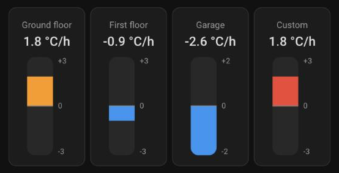

# Variation Bar Card

[](https://hacs.xyz/docs/faq/custom_repositories/)
[](https://github.com/gkuik/variation-bar-card/releases)
[](https://github.com/gkuik/variation-bar-card/actions/workflows/ci.yml)

A Home Assistant dashboard card showing a **bar centred on zero**: it grows upwards (or to
the right) in orange when the value is positive and downwards (or to the left) in blue when
it is negative.

Made for values that go both ways, such as the **rate of change of a temperature** (°C/h),
a power balance or a pressure trend.



## Features

- Zero is always in the middle; the scale goes from `-amplitude` to `+amplitude`, with
  graduations.
- Values beyond the amplitude are clamped to the end of the bar.
- Vertical or horizontal bar: the horizontal one fits a wide, low card.
- The bar always animates from the centre: going from positive to negative, it first
  shrinks back to 0, then grows on the other side.
- Looks and behaves like a built-in card: theme colours (light and dark), ripple effect,
  standard tap actions, sections view sizing.
- Configurable colours: theme colours (`orange`, `red`, `teal`…) or any CSS colour.
- Visual editor, in English and French.

## Installation

### HACS (recommended)

[](https://my.home-assistant.io/redirect/hacs_repository/?owner=gkuik&repository=variation-bar-card&category=plugin)

Or manually:

1. In HACS, open the menu **⋮ → Custom repositories**.
2. Add `https://github.com/gkuik/variation-bar-card` with the type **Dashboard**.
3. Search for **Variation Bar Card**, download it and reload your browser.

### Manual

1. Download `variation-bar-card.js` from the
   [latest release](https://github.com/gkuik/variation-bar-card/releases/latest) into the
   `config/www/` folder of Home Assistant.
2. **Settings → Dashboards → ⋮ → Resources → Add resource**:
   URL `/local/variation-bar-card.js?v=0.1.0`, type **JavaScript module**
   (requires *Advanced mode* in your user profile). Change `?v=` on every update so that
   browsers fetch the new file.

## Configuration

Add the card from the card picker (**Variation bar**) and use the visual editor, or in YAML:

```yaml
type: custom:variation-bar-card
entity: sensor.temperature_rate_of_change
```

| Option           | Type   | Default                      | Description                                                    |
| ---------------- | ------ | ---------------------------- | -------------------------------------------------------------- |
| `entity`         | string | **required**                 | Numeric entity (`sensor`, `number`, `input_number`).           |
| `name`           | string | entity name                  | Name shown above the value.                                    |
| `amplitude`      | number | `3`                          | The scale goes from `-amplitude` to `+amplitude`. Must be > 0. |
| `orientation`    | string | `vertical`                   | `vertical` (positive upwards) or `horizontal` (positive to the right). |
| `color_positive` | string | `orange`                     | Bar colour above 0: theme colour name or CSS colour.           |
| `color_negative` | string | `blue`                       | Bar colour below 0: theme colour name or CSS colour.           |
| `tap_action`     | object | `{ action: more-info }`      | Standard [tap action](https://www.home-assistant.io/dashboards/actions/). |

### Examples

Temperature rate of change of a floor, from -2 to +2 °C/h:

```yaml
type: custom:variation-bar-card
entity: sensor.ground_floor_temperature_rate
name: Ground floor
amplitude: 2
```

Horizontal bar (half width and 2 rows high by default in the sections view):

```yaml
type: custom:variation-bar-card
entity: sensor.living_room_temperature_rate
orientation: horizontal
amplitude: 2
```

Custom colours and no tap action:

```yaml
type: custom:variation-bar-card
entity: sensor.grid_power_balance
amplitude: 5000
color_positive: red
color_negative: "#26a69a"
tap_action:
  action: none
```

> **Tip:** to get a rate of change from a temperature sensor, add a
> [Derivative](https://www.home-assistant.io/integrations/derivative/) helper with the time
> unit set to hours.

## Development

Requires Node 22.

```bash
npm ci
npm run watch     # rebuilds on every change (dist/ or HA_WWW_DIR)
npm run build     # typecheck + production build into dist/
npm run lint      # eslint + prettier
```

To test in a development Home Assistant instance, copy `.env.example` to `.env.local` and set
`HA_WWW_DIR` to its `config/www` folder: builds go straight there, served on `/local/`.

### Releasing

1. Bump `version` in `package.json` and commit.
2. Push a matching tag: `git tag v0.1.0 && git push origin v0.1.0`.
3. The **Release** workflow builds the card and publishes a GitHub release with
   `variation-bar-card.js` attached, which HACS offers as an update.

Tested with Home Assistant 2026.10.

## License

[MIT](LICENSE)
